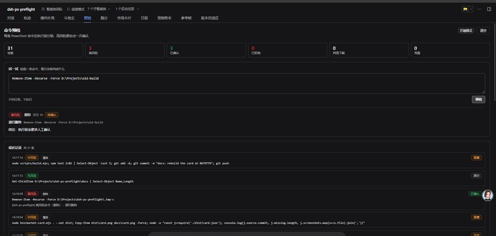
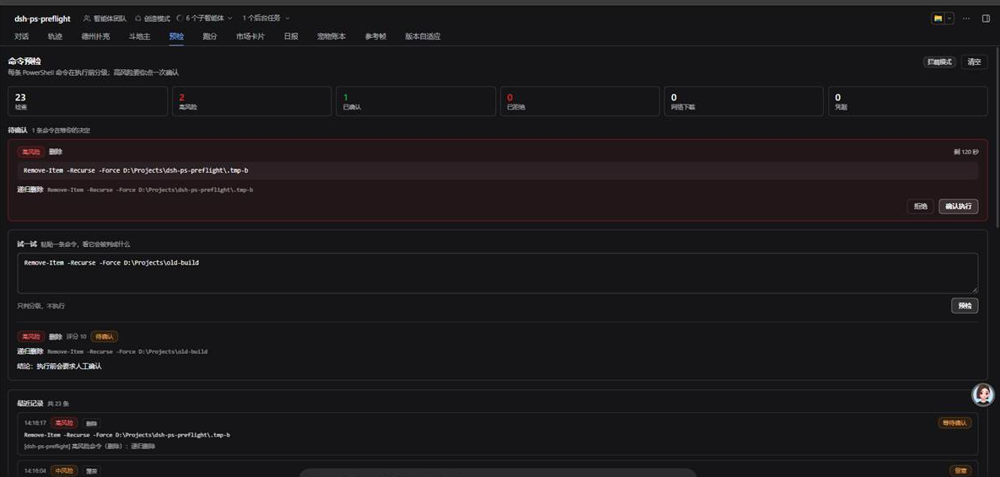

# dsh-ps-preflight

[](https://github.com/dingchenhui0618-arch/dsh-ps-preflight/actions/workflows/ci.yml)
[](LICENSE)


**给 agent 跑的每一条 PowerShell 命令做执行前静态分级：删除 / 覆盖 / 网络下载 / 触碰凭据四类，
高风险必须二次确认，每条命令和它的判定都写进本地审计日志。**

零依赖、不联网、不调模型。判定是同步的纯函数，一条命令亚毫秒出结果。





## 为什么要有它

在 agent 里，「能执行 PowerShell」和「能删库」是同一条授权。现有的控制面管的是**范围**——
哪些目录能碰、要不要审批、沙箱开不开；它不管**这条命令本身危不危险**。一条
`Remove-Item -Recurse -Force` 落在已授权目录里，照样是不可逆的。

> 说明：上面这句是关于「权限类机制通常按范围授权」的**设计前提**，不是对某个具体实现的
> 实测结论。把它当设计动机看，不要当已经验证过的事实。

这个插件补的是另一层：**在命令进 shell 之前，按它的文本特征给出一个可解释的档位**，
并且把这次判定落成可复查的记录。

## 它做什么

1. **每条命令都过一遍**：`pwsh` / `powershell` 工具调用在 `tools/pre-execute` 上被拦一次，
   给 `none` / `low` / `medium` / `high` 四档之一，附命中规则、评分、命令摘要。
2. **四类必测**：删除、覆盖、网络下载、触碰凭据；另加三类实测同样致命的：动态执行
   （`iex` / `-EncodedCommand` / `ScriptBlock::Create`）、系统改动、权限改动。
3. **组合升级**：下载**且**执行、读凭据**且**外发，各自直接升到 `high`——单看每一步都不致命，
   连起来是投递链。
4. **高风险二次确认**：停住这次工具调用，等人点一下（面板里）或走 harness 原生审批。
5. **全量审计**：每条命令一行 JSON 落盘，含脱敏后的命令原文和最终决定。

## 风险档

| 档位 | 含义 | 动作 |
| --- | --- | --- |
| `none` | 只读、查询、`git status`、`node --test` 之类 | 放行 |
| `low` | 可恢复的写（追加、复制、删除单个命令行能覆盖的东西） | 放行 |
| `medium` | 单文件删除、覆盖、重定向、下载、读凭据路径 | **记录，不拦** |
| `high` | 递归删除、磁盘级破坏、删库、强制推送、下载并执行、凭据外发、系统/权限改动 | **二次确认**，拒绝或超时即不执行 |

`medium` 故意不拦：单文件覆盖和下载在正常工作里太常见，每次都要点一下会把人逼到关掉插件。
真正的分界线放在「不可逆」上。

## 判定依据（部分例子）

| 类别 | 判 `high` | 判 `medium` |
| --- | --- | --- |
| 删除 | `rm -Recurse -Force`、`rm -rf`、`del /s`、`rd /s /q`、`robocopy /MIR`、`format`、`Clear-Disk`、`DROP TABLE`、`git clean -fd`、`[System.IO.Directory]::Delete($p, $true)`、`x.Delete($true)`、`Get-ChildItem -Recurse \| Remove-Item` | `Remove-Item 单个文件`、`Remove-Item *.log`、`x.Delete()` |
| 覆盖 | `git push --force`、写 `.env` / `.dsh/.credentials` / `AGENTS.md` | `Set-Content`、`>`、`Copy-Item -Force`、`git reset --hard` |
| 网络下载 | 下载后执行（`iwr \| iex`、`iex (irm …)`） | `Invoke-WebRequest`、`Start-BitsTransfer`、`certutil -urlcache`、`DownloadString()` |
| 凭据 | 读凭据 + 外发、写凭据路径、`reg save … SAM` | 读 `.ssh/id_rsa`、`.aws/credentials`、`.env`、`Get-Credential` |
| 动态执行 | `iex $变量`、`-EncodedCommand`（并**解码后再分析**一遍）、`[scriptblock]::Create` | `iex '固定字符串'`（只把这条字符串当命令再判一次） |
| 系统 / 权限 | `shutdown`、`reg add HKLM`、`net user x pwd /add`、`icacls /grant Everyone:F`、`vssadmin delete shadows`、`wevtutil cl` | `reg query`、`schtasks /create`、`Set-ExecutionPolicy -Scope Process` |

反转也有照顾：`Remove-Item -Recurse:$false` 不算递归；`Remove-Item -WhatIf` 按空跑降到 `low`；
`Write-Output "rm -rf /demo"` **不判**——引号里的是数据，除非它处在执行入口
（`iex` / `-Command` / `cmd /c`），那时才递归进去看。

## 二次确认的两条通道

| 通道 | 什么时候用 | 结果 |
| --- | --- | --- |
| **面板内确认**（默认优先） | 「预检」面板最近 8 秒内还在轮询（有人在看） | 命令停住，卡片上有倒计时和 `拒绝 / 确认执行`；120 秒没人点 = **拒绝** |
| **harness 原生审批** | 面板没开、或在别的窗口 | 交给 `tools` 的 `ask`；会话 approval policy 为 `never` 时**失败关闭**，等于拒绝 |

`confirmMode: auto`（默认）在两者之间自动选；可以强制成 `panel` 或 `ask`。
`mode: audit` 则完全只记录、不拦。

待确认的队列是**宿主级**的：同一个 DSH 进程里任何会话的高风险命令都会进同一个队列，
因为看的人只有一个。

## 审计

- 路径：`$DSH_HOME/ps-preflight-audit.jsonl`（默认 `~/.dsh/ps-preflight-audit.jsonl`，可用
  `auditPath` 改）。
- 每行：`at`（ISO 时间）、`id`、`tool`、`tier`、`score`、`categories`、`decision`、`reason`、
  `mode`、`findings`（命中规则 id）、`command`（**脱敏后**，截断到 300 字符）、`ms`。
- `decision` 取值：`pass` / `watch` / `audit` / `ask` / `pending` / `allow` / `deny` / `degraded`。
- 等待过人工的高风险命令写**两行**：分析行（`pending`，在等人之前就落盘）和结论行
  （`allow` / `deny`，带 `resolutionOf` 指回分析行的 `id`）。这样即使进程中途死掉，
  也能看出「有一条命令曾经在等人」。
- 超过 2 MB 轮转一次到 `.1`（只留一代）。
- 脱敏覆盖 GitHub token、`sk-` 密钥、AWS access key、Slack token、JWT、`Bearer` 值、
  `password=` / `token=` / `secret=` 这类键值、PEM 私钥块。**这是模式匹配，不是保证**。

## 安装

```bash
# 从 npm（发布后）
dsh plugin --profile <你的 profile> add dsh-ps-preflight

# 或直接从 GitHub 源码
dsh plugin --profile <你的 profile> add github:dingchenhui0618-arch/dsh-ps-preflight
```

装完在对话视图顶部多一个「预检」tab。**不需要任何配置就能用**，默认就是 `enforce`。

## 配置

全部可选项，写在插件 config 里（`cordis.patch.yml` 的 `- id: dsh-ps-preflight` 条目下）：

| 键 | 默认 | 说明 |
| --- | --- | --- |
| `mode` | `enforce` | `audit` = 只记录不拦 |
| `confirmMode` | `auto` | `panel` / `ask` / `auto` |
| `confirmTimeoutMs` | `120000` | 面板里等多久算拒绝 |
| `panelWindowMs` | `8000` | 面板多久内轮询过算「有人在看」 |
| `tools` | `["pwsh","powershell"]` | 拦哪些工具名 |
| `auditPath` | `$DSH_HOME/ps-preflight-audit.jsonl` | 审计文件 |
| `maxAuditBytes` | `2097152` | 超过就轮转 |

## 面板

- **计数**：检查条数、高风险、已确认、已拒绝、网络下载、凭据——六个数一眼看完。
- **待确认**：有的话排在最上面，显示命令原文、命中条目、倒计时和两个按钮。
- **试一试**：粘一条命令进去点「预检」，只分级、不执行。适合在真正跑之前看看会怎么判。
- **最近记录**：每条一行时间、档位、分类、决定，命令单行省略，拒绝的行带红描边。
- **审计路径**：底部常驻显示文件位置和大小。

## 和 dsh-warden 的关系

新方向、独立实现，没有 fork、没有把别人的仓库当基座。**参考了**自己之前的
[`dsh-warden`](https://github.com/dingchenhui0618-arch/dsh-warden) 的工程骨架：
零依赖构建脚本、host/client 双半区、`cordis.patch.yml`、`tools/pre-execute` 钩子的接法、
面板继承宿主主题的做法。判定逻辑、面板内容、审计格式都是这次新写的。

不同点（这也是这个项目存在的理由）：

| | dsh-warden | dsh-ps-preflight |
| --- | --- | --- |
| 判定方式 | 本地正则筛完再**调一次模型** | **纯规则，不调模型**：离线、确定、可解释、零延迟、零成本 |
| 覆盖面 | 只有命中正则的调用才送审 | **每条命令**都分级、都落审计 |
| 是否拦 | 永不 `ask`，只放行或拒绝 | 高风险**一定**二次确认（面板或原生审批） |
| 字符串里的危险字样 | 会连带拦（`Write-Output "rm -rf"` 被送审） | 引号里当数据，除非处在执行入口 |
| 数据出口 | 命令参数会发给模型 provider | **一个字都不出本机** |
| 面板 | 显示模型判定 | 干跑分级 + 待确认队列 + 最近记录 |

## 它不做什么

- **不是安全边界**。同进程的插件本来就能绕过 `tools/pre-execute`，也能改审计文件。
  它降低误操作概率，不防恶意代码。
- **不是 PowerShell 解析器**。运行时拼出来的字符串（`& ('Remove' + '-Item')`）、自定义函数、
  动态别名、从文件读进来的脚本，都看不见。
- **只看命令文本**。命令跑完改了什么、读到了什么，不在范围内。
- **不覆盖 `bash` / `computer`**（往终端里敲键盘那种）。
- **不做通用风险模型**。组合升级只写了「下载+执行」「凭据+下载」两条。
- **`.env.example` 这类模板已经排除**，但 `.env.production` 会被当凭据——保守方向。
- **审计写失败会被吞掉**：磁盘满或权限不足时，你只会得到「没有审计记录」，调用本身不受影响。
- **分析器异常时放行**：失败方向是「什么都不做」，日志里记一行 `degraded`。

## 开发

```bash
node scripts/build.mjs      # src/ -> lib/（零依赖，不用装任何东西）
npm test                    # 136 条测试
```

136 条测试分三组：`test/analyze.test.mjs`（31 条，规则与档位）、
`test/analyze.adversarial.test.mjs`（83 条，专门试图打穿判定：别名、参数缩写、`-Recurse:$false`、
`-EncodedCommand`、嵌套 `-Command`、`cmd /c`、通配符、盘根、here-string、误报回归）、
`test/host.test.mjs`（22 条，用假 ctx 驱动真实 `apply()`：放行、留意、原生审批、面板确认/拒绝/
超时、`audit` 模式、审计脱敏与轮转、卸载时结算待确认、`webServer` 不可用时降级）。

`lib/` 是构建产物，**入库**——用户装的是它；CI 会验证 `lib/` 与 `src/` 一致。

## License

MIT
